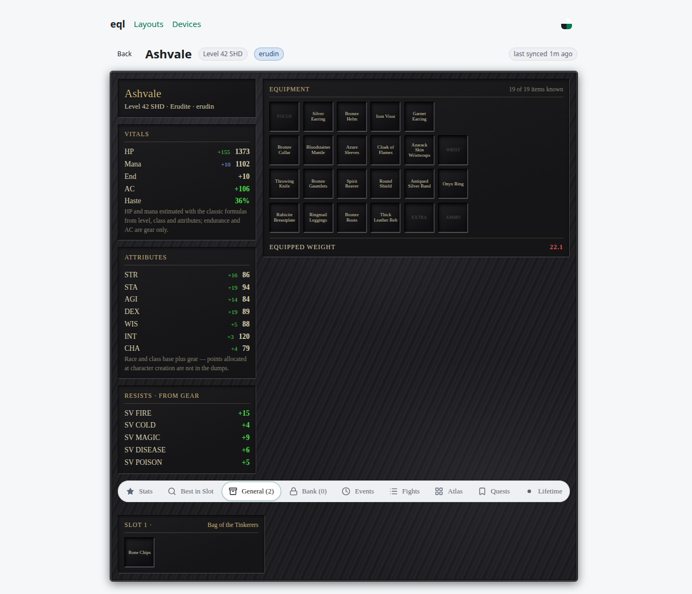
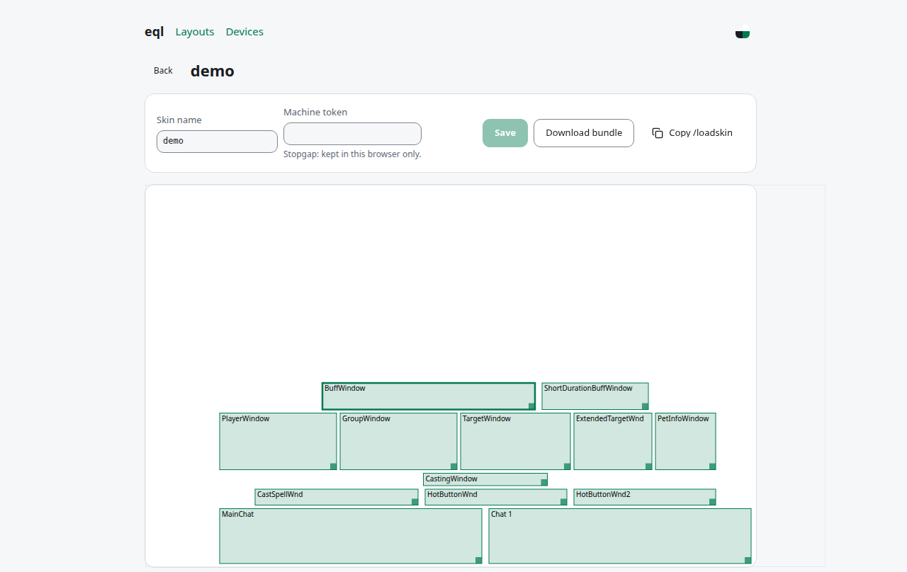

# eql

EverQuest Legends character profiles: a daemon on the game PC uploads gear, stats and fights to a web page.

[](https://github.com/DorskFR/eql/releases)
[](https://github.com/DorskFR/eql/actions/workflows/ci.yml)

<picture>
  <source media="(prefers-color-scheme: dark)" srcset="docs/assets/profile-dark.png">
  
</picture>

Magelo-style. `eqld` uploads the client's dumps and logs; `eqls` stores them in Postgres, joins a fan-wiki item database and serves the UI. Unofficial, see [Trademarks](#license-and-trademarks).

## Features

- Equipment, stats and resists summed from items, best in slot, bags, bank.
- Chat-log events and per-fight damage and healing.
- eqld for Windows, macOS arm64, Linux x86_64/aarch64, Wine, Winlator.

## Quick start

### 1. Run the server

```yaml
# compose.yaml
services:
  eqls:
    image: ghcr.io/dorskfr/eqls:0.24.3
    ports: ["8080:8080"]
    environment:
      DATABASE_URL: postgres://eql:eql@db/eql
      EQLS_MACHINE_TOKEN: change-me
    depends_on: [db]
  db:
    image: pgautoupgrade/pgautoupgrade:18-alpine
    environment:
      POSTGRES_USER: eql
      POSTGRES_PASSWORD: eql
      POSTGRES_DB: eql
    volumes: ["./data:/var/lib/postgresql"]
```

```sh
docker compose up -d
curl http://localhost:8080/api/v1/version
```

```
{"version":"0.24.3"}
```

UI at http://localhost:8080. Reads are public, writes need `EQLS_MACHINE_TOKEN`. Back up `./data`.

Fill the item database once (slow):

```sh
docker compose exec eqls eqls scrape
```

### 2. Run the daemon on the game machine

Binaries on the [latest release](https://github.com/DorskFR/eql/releases/latest): `eqld-windows-x86_64.exe`, `eqld-macos-aarch64`, `eqld-linux-x86_64`, `eqld-linux-aarch64`. Config:

```toml
[game]
root = 'C:\Users\Public\Daybreak Game Company\Installed Games\EverQuest Legends'

[api]
url = "http://your-server:8080"
token = "change-me"
```

```sh
eqld eqld.toml
```

In game, `/outputfile inventory`:

```
INFO eqld::daemon: uploading inventory character=Ashvale server=erudin entries=2
INFO eqld::daemon: uploaded inventory character=Ashvale server=erudin entries=2 status=201
```

The character appears at `/c/<server>/<name>`.

## Usage

### Put the dumps on one button

```sh
eqld eqld.toml install-social
```

Adds the `EQLD` social to every character's hotbar 1. See [docs/eqld.md](docs/eqld.md#the-in-game-eqld-button).

### Design a UI layout and install it

<picture>
  <source media="(prefers-color-scheme: dark)" srcset="docs/assets/designer-dark.png">
  
</picture>

**Layouts** → **Clone default**, name it `myui`, arrange the windows. Then:

```toml
[skin]
enabled = true
layout = "myui"
```

Installed as `uifiles/myui/` when the game closes; `/loadskin myui` in game. See [docs/skins.md](docs/skins.md).

### Track fights, quests and lifetime DPS

```toml
[tools.log_reader]
enabled = true
overlays = ["dps"]
hidden = ["dps"]
```

Runs a patched third-party log reader every two minutes. See [docs/log-reader.md](docs/log-reader.md).

### Show item icons

```sh
eqld eqld.toml upload-icons
```

## Configuration

Full reference: [docs/eqld.md](docs/eqld.md). eqls variables: [docs/development.md](docs/development.md#running-eqls-locally).

| eqld key | Default | Effect |
|---|---|---|
| `game.root` | required | The game folder, the one holding `eqgame.exe` |
| `api.url`, `api.token` | required | eqls base URL and its machine token |
| `game.poll_secs` | `5` | Seconds between scans of the game folder |
| `socials.enabled` | `false` | Keep the `EQLD` button applied after each session |
| `skin.enabled`, `skin.layout` | `false`, none | Keep a layout from the server installed |
| `tools.log_reader.enabled` | `false` | Run the log reader and upload fights, quests and lifetime stats |
| `log.upload` | `true` | Send eqld's own log to the server, readable under **Devices** |

## How to update

```sh
docker compose pull && docker compose up -d
```

Bump the image tag in `compose.yaml` first. eqld does not self-update: replace it with the binary from the same release.

## Limitations

- Items missing from the fan wiki have no stats.
- HP and mana are estimates; creation-time point allocation is not in the dumps.
- Social and skin are written only while the game is closed.
- No accounts: one machine token per server, all profiles public.
- Phones: [docs/winlator.md](docs/winlator.md).

## Development

```sh
git clone https://github.com/DorskFR/eql && cd eql
cargo test --workspace
(cd web && npm ci && npm test)
```

See [docs/development.md](docs/development.md).

## License and trademarks

MIT (`Cargo.toml`); no LICENSE file yet.

EverQuest is a registered trademark, and EverQuest Legends a trademark, of Daybreak Game Company LLC in the United States and/or other countries. eql is an unofficial fan tool, not affiliated with, endorsed by or sponsored by Daybreak Game Company LLC.

No game art or client binaries included. eqld never touches the client binary, memory or network ([details](docs/eqld.md#what-eqld-touches)). Daybreak's [Terms of Service](https://www.daybreakgames.com/terms-of-service) apply.
